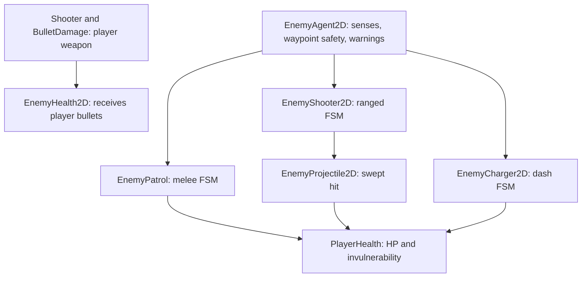

# Script map for the 2–3 minute video

| Script | States | Main rule |
|---|---|---|
| EnemyPatrol | Patrol → Chase → WindUp → Attack → Recover → Return | Chase only inside the territory; hit once after warning, only in range with clear sight |
| EnemyShooter2D | Scan → Aim → Shoot → Cooldown | Capture aim at detection; warn visibly; do not follow the player with the locked shot |
| EnemyCharger2D | Patrol → WindUp → Dash → Recover → Return | Capture direction before dashing; cannot steer; wall/ground checks stop movement |

Shared code is not shared behaviour: the three Update methods make different decisions. EyePoint is the ray origin; distance, facing angle and the first ray hit determine sight. Waypoint objects stay outside moving enemy hierarchies. Enemy projectiles sweep their movement so a slow phone frame cannot skip a wall/player. EnemyHealth accepts existing BulletDamage bullets; PlayerHealth owns HP, blinking and invulnerability.

The SVG next to this file is a compact visual you can open and show while recording.
